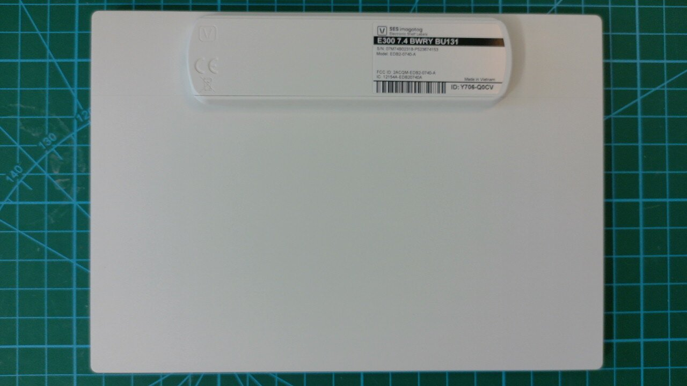
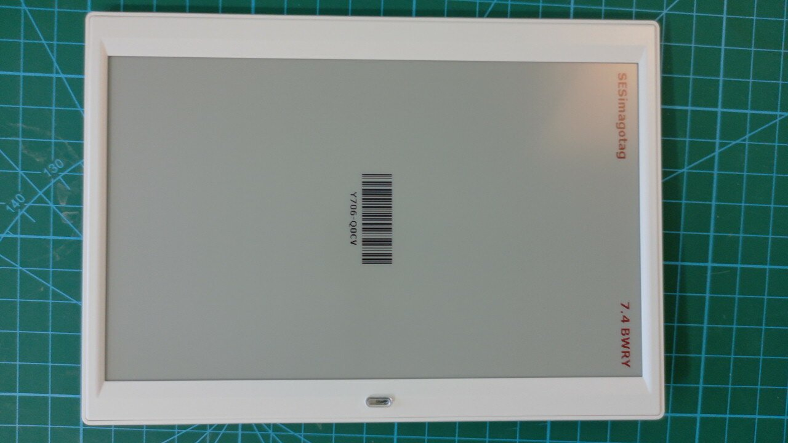
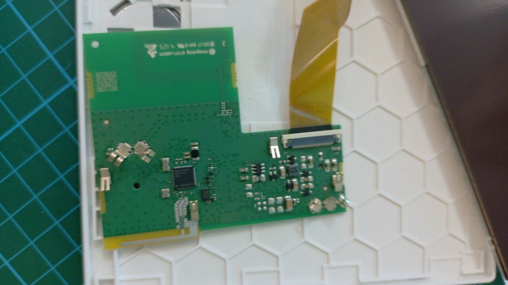
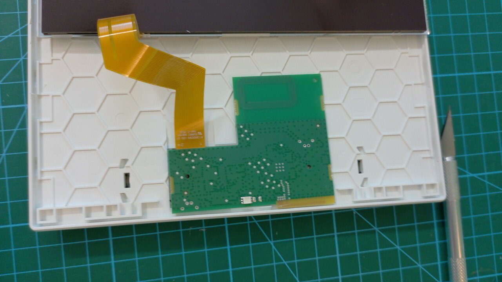
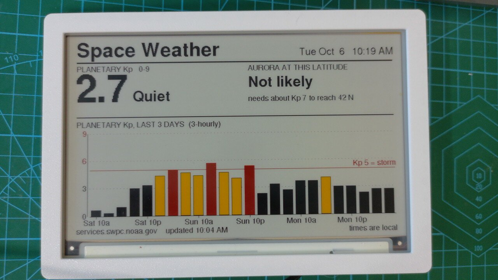

# Driving an Imagotag E300 7.4" BWRY from a generic Waveshare driver board

Surplus **Vusion / SES-imagotag E300 7.4"** electronic shelf labels turn up cheaply on eBay. The
panel inside is a **Pervasive Displays E2741QS0B3** (741-QS-0B) "Spectra 4" — 480×800, four
colours: black, white, red and yellow. It can be driven directly from a stock **Waveshare e-Paper
ESP32 Driver Board (Rev3)** with no adapter board and no level shifting.



## Identifying the right unit

The label on the back is what to search for and check against:

| Field | Value |
|---|---|
| Product | **E300 7.4 BWRY BU131** |
| Model | **EDB2-0740-A** |
| FCC ID | **2ACQM-EDB2-0740-A** |
| Vendor | SES-imagotag (Vusion) |

`BWRY` is the colour set — black, white, red, yellow. `BU131` is SES's variant code and `EDB2` the
generation; both appear on the label even though neither shows up in any panel datasheet. The panel
*inside* is a Pervasive Displays **E2741QS0B3** ("741-QS-0B", Spectra 4), and that is the part the
driver library cares about. If a listing shows the back label, match on **EDB2-0740-A** or the FCC
ID — a different E300 variant may carry a different panel.

Units are usually sold used, still holding their last shelf image, since e-paper keeps its picture
with no power:



## Harvesting the panel

You are not hacking the ESL — its radio and firmware stay untouched and unused. You open the case,
take out the original board, and plug the panel's own ribbon into a generic driver board.



The case is snap-fit around the seam; work a thin blade around it rather than prying at a corner.
Inside, the panel's FPC runs into a white ZIF connector on the ESL mainboard — lift the connector's
latch, slide the ribbon out, and the panel is free. The mainboard, radio and battery contacts are
then scrap: nothing on them is used, and nothing on them is needed again.



Handle the ribbon by its stiffener, not the tail. It is the only connection to the panel and it is
not replaceable.

## What you need

- **Waveshare e-Paper ESP32 Driver Board** (ESP32-WROOM-32E) — sold as "Universal e-Paper Raw
  Panel Driver Board"; the one used here is Rev3
- The E300's panel, ribbon intact


- **`bb_epaper` from git master** — not the Arduino Library Manager release. The panel constant
  `EP74YR_480x800` only exists on master:
  ```bash
  git clone https://github.com/bitbank2/bb_epaper
  arduino-cli compile --library ./bb_epaper ...
  ```

## Wiring

None to do — the panel's FPC goes straight into the driver board's connector, and every signal is
hard-wired on the PCB:

| Signal | GPIO |
|---|---|
| BUSY | 25 |
| RST  | 26 |
| DC   | 27 |
| CS   | 15 |
| CLK  | 13 |
| DIN  | 14 |

FPC ribbons have contacts on one side only. If the panel does nothing at all, reseat it the other
way up before suspecting the code — a flipped ribbon looks exactly like dead firmware.

## Minimal working sketch

```cpp
#include <bb_epaper.h>

#define DC_PIN 27
#define RESET_PIN 26
#define BUSY_PIN 25
#define CS_PIN 15
#define SCK_PIN 13
#define MOSI_PIN 14

BBEPAPER bbep(EP74YR_480x800);

void setup() {
  bbep.initIO(DC_PIN, RESET_PIN, BUSY_PIN, CS_PIN, MOSI_PIN, SCK_PIN);
  bbep.allocBuffer();
  bbep.fillScreen(BBEP_WHITE);
  bbep.fillRect(0, 0,   bbep.width(), 60, BBEP_BLACK);
  bbep.fillRect(0, 120, bbep.width(), 60, BBEP_RED);
  bbep.fillRect(0, 240, bbep.width(), 60, BBEP_YELLOW);
  bbep.refresh(REFRESH_FULL, true);
  bbep.sleep(DEEP_SLEEP);
}
void loop() {}
```

Note the `initIO` argument order: **MOSI before SCK**. A full refresh takes about **23 seconds** and
there is no fast or partial mode — budget for that in anything time-sensitive.

Native orientation is portrait 480×800; use bb_epaper rotation 90 for landscape 800×480.

## Gotchas worth knowing before you start

**The frame buffer will starve your TLS stack.** `allocBuffer()` takes ~96 KB for a full frame. That
is fine for the demo above, but on a WROOM-32 with no PSRAM it leaves too little heap for
HTTPS once Wi-Fi is up. For anything networked, skip `allocBuffer()` entirely, render the screen in
vertical bands and stream each band straight to the panel with `writeCmd(0x10)` followed by
`writeData(...)` per band. See `pushScreen()` in `WeatherPanel4C/`.

**This panel needs its init sequence re-sent before every frame.** It is flagged
`BBEP_NEEDS_EXTRA_INIT`, meaning the resolution has to go out ahead of the pixel data on each
refresh, not just once at boot:

```cpp
void bbepSendCMDSequence(BBEPDISP *pBBEP, const uint8_t *pSeq);   // internal, bb_ep.inl
bbepSendCMDSequence(&bbep._bbep, bbep._bbep.pInitFull);
```

Miss this and you get a blank or garbled panel with no error.

**bb_epaper has no Adafruit GFX font support.** Its built-in fonts are fixed bitmaps. If you want
GFX fonts, write a thin `Adafruit_GFX` subclass whose `drawPixel` writes into your band buffer and
let bb_epaper handle only init, commands, refresh and sleep.

**bb_epaper does not clip.** It rejects any rectangle with a corner off-screen and does not clamp x
at all. Clip in your own drawing layer or you will lose whole primitives silently.

**Yellow is faint on white.** It reads poorly below about 12 pt and almost disappears in daylight.
Ring yellow text in black and reserve it for a "caution" tier between black and red — that is how
`WeatherPanel4C/` uses it for UV 3–5, AQI 51–100, Kp 4, and similar middle bands.

**Sleep it between refreshes.** `bbep.sleep(DEEP_SLEEP)` after each frame, then `bbep.wake()` plus a
re-init before the next. The panel holds its image at zero power.

## Working examples in this repo

| Sketch | What it does |
|---|---|
| `Imagotag74Test/` | Smallest possible bring-up — colour bars and text. Start here. |
| `WeatherPanel4C/` | Full weather/finance dashboard, banded rendering, GFX font bridge |
| `NDLPanel/` | Branded message panel with an HTTP API |
